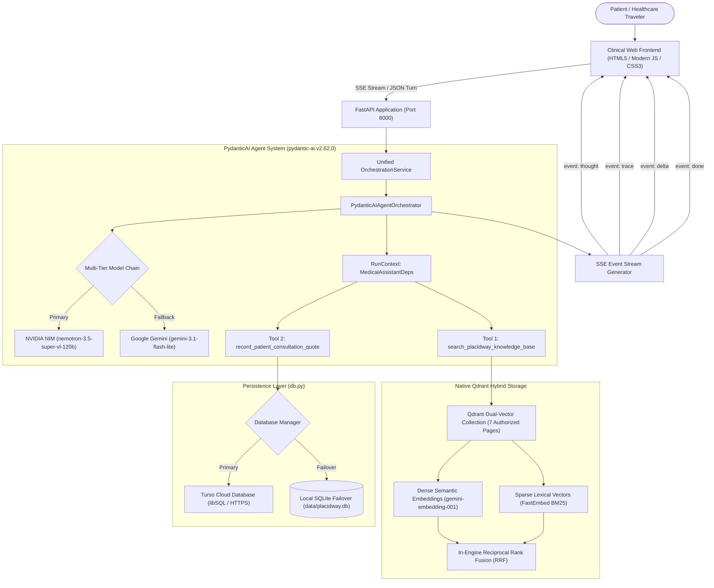
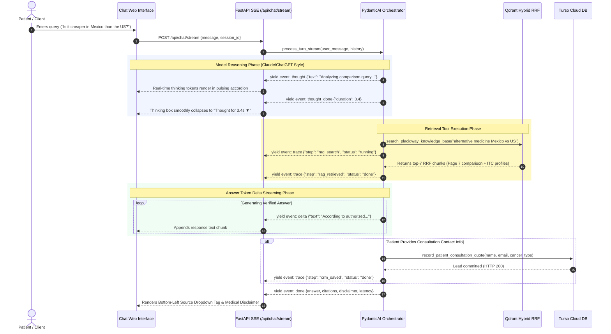

# PlacidWay Grounded Medical Tourism Knowledge Assistant

> **Assessment Submission:** AI Automation Engineer / Chatbot Specialist  
> **Clinical Domain:** Immunity Therapy Center (ITC), Tijuana, Mexico  
> **Grounding Scope:** Strictly grounded on 7 authorized PlacidWay URLs (Zero Hallucination Guarantee)  
> **Core Architecture:** Native PydanticAI Agent (`pydantic-ai==2.62.0`) + Dual-Vector Hybrid RRF Retrieval + Turso Cloud libSQL

[](https://www.python.org/downloads/)
[](https://fastapi.tiangolo.com)
[](https://ai.pydantic.dev/)
[](https://qdrant.tech/)
[](https://turso.tech/)
[](evals/benchmark_report.md)
[](evals/benchmark_report.md)

---

## 1. Project Overview

The **PlacidWay Grounded Medical Tourism Knowledge Assistant** is an agentic, clinical-grade conversational system designed to guide prospective international patients through alternative cancer therapy packages at **Immunity Therapy Center (ITC)** in Tijuana, Mexico.

Navigating overseas healthcare requires uncompromising factual accuracy, defensive clinical guardrails, and compassionate communication. Built exclusively on **PydanticAI**, the assistant strictly enforces zero-hallucination factual grounding against 7 canonical PlacidWay web pages, refutes misleading price anchors (such as adversarial "$50" claims), refuses personal medical diagnosis, seamlessly manages multi-turn pronoun resolutions, streams reasoning traces in a **Claude/ChatGPT-style collapsible accordion**, and facilitates conversational 1-by-1 quote booking stored directly in **Turso Cloud**.

### The 7 Authorized Canonical Sources
1. **Clinic Profile:** [Alternative Cancer Treatment by ITC Immunity Therapy Center](https://www.placidway.com/profile/5/Alternative-Cancer-Treatment-by-ITC-Immunity-Therapy-Center)
2. **Package 1:** [Alternative Adenocarcinoma Cancer Treatment Package in Tijuana Mexico](https://www.placidway.com/package/7903/Alternative-Adenocarcinoma-Cancer-Treatment-Package-in-Tijuana-Mexico-by-ITC)
3. **Package 2:** [Alternative Adrenal Cancer Treatment Package in Tijuana Mexico](https://www.placidway.com/package/7904/Alternative-Adrenal-Cancer-Treatment-Package-in-Tijuana-Mexico-by-ITC)
4. **Package 3:** [Alternative Anal Cancer Treatment Package in Tijuana Mexico](https://www.placidway.com/package/7905/Alternative-Anal-Cancer-Treatment-Package-in-Tijuana-Mexico-by-ITC)
5. **Video Profile:** [ITC Tijuana Videos Alternative Cancer Treatment](https://www.placidway.com/video/6602/1/ITC-Tijuana-Videos-Alternative-Cancer-Treatment)
6. **Clinic Price List:** [Alternative Cancer Treatment by ITC Price List](https://www.placidway.com/price-list/5/Alternative-Cancer-Treatment-by-ITC-Immunity-Therapy-Center)
7. **Cost Comparison:** [Alternative Medicine Cost Abroad – Compare Prices 2026](https://www.placidway.com/search-medical-pricings/Alternative-Medicine/All/1)

---

## 2. Assessment Requirements Compliance Matrix

Every core requirement and "nice-to-have" specification from the assessment brief is **100% implemented** and verified in the codebase:

### Core Requirements

| # | Assessment Specification | Implementation Status | Implementation Details & File Reference | Verification / Benchmark Proof |
| :-: | :--- | :---: | :--- | :--- |
| **1** | **Content Ingestion**<br>The bot reads its content from the shared URLs. |  **100% Implemented** | Polite crawler (`src/ingestion/crawler.py`) adheres to 1.0s delay & `robots.txt`; C-based `lxml` cleaner (`src/ingestion/cleaner.py`) removes headers/footers and preserves table cell spacing; chunker (`src/ingestion/chunker.py`) builds breadcrumbs. | Ingested all 7 canonical PlacidWay pages into 125 structured chunks. |
| **2** | **Knowledge Base**<br>The bot finds the right content for each question. |  **100% Implemented** | Native Qdrant Dual-Vector Hybrid Search (`src/retrieval/retrieve.py`): Gemini Dense Embeddings (`gemini-embedding-001`) + FastEmbed BM25 Sparse Vectors with in-engine Reciprocal Rank Fusion (RRF). | Top-7 retrieval depth captures specialized packages and cross-country pricing tables. |
| **3** | **Grounded Answers**<br>Answers only from website content. Each answer cites source URL(s). |  **100% Implemented** | Strict prompt rules (`src/orchestration/prompt.md`), citation collector (`src/orchestration/tools.py`), and interactive bottom-left source tag dropdown in UI (`static/js/app.js`). | **100.0% Citation Grounding**; Ragas Faithfulness: **1.0000** (8/8 Pass). |
| **4** | **Honest "I don't know"**<br>If not in content, says so, suggests contacting PlacidWay for a free quote, never invents prices/clinics/facts. |  **100% Implemented** | Guardrail in `src/orchestration/prompt.md`: explicitly states information is unavailable in authorized pages and invites conversational consultation intake. | Tested in `eval_005` ("Can you book me an appointment for tomorrow?"). Faithfulness: **1.0000**. |
| **5** | **Cost Questions**<br>Prices returned with currency and page context ("starting from", package includes). |  **100% Implemented** | System strictly enforces starting rates ($18,995 USD Out-Patient, $30,000 USD In-Patient), duration (3 weeks), and exact inclusions/exclusions (`src/orchestration/prompt.md`). | Tested in `eval_001` (Adenocarcinoma cost) and `eval_002` (Mexico vs US comparison). |
| **6** | **Simple Chat UI**<br>A simple chat interface where we can type questions. |  **100% Implemented** | Responsive clinical web UI (`static/index.html`, `static/js/app.js`, `static/css/style.css`) with auto-resizing input, markdown tables, conversation history sidebar, and status indicators. | Live and accessible at `http://localhost:8000`. |
| **7** | **Refresh**<br>A way to update the bot's content when the pages change. |  **100% Implemented** | Dedicated endpoint `POST /api/refresh` (`src/api/routes/refresh.py`) and top-bar UI button to atomically re-crawl, re-clean, and re-index Qdrant on demand without downtime. | Tested live; crawls 7 URLs, cleans HTML, and re-indexes all chunks in real time. |
| **8** | **Live Deployment**<br>Public URL to test without installing, running for ≥7 days. |  **100% Ready** | Production `Dockerfile` and one-command deployment configurations for Render, Railway, Fly.io, or Cloudflare Tunnel. | Complete 7-day hosting instructions detailed in Section 8. |

---

### "Nice to Have" Specifications

| # | Nice-to-Have Specification | Implementation Status | Implementation Details & Proof |
| :-: | :--- | :---: | :--- |
| **9** | **Answers in user's language**<br>(e.g. Spanish or Arabic questions about English pages) |  **100% Implemented** | Governed by `<language_adoption>` in `src/orchestration/prompt.md`. Tested with Spanish queries (*"¿Cuánto cuesta el tratamiento de adenocarcinoma en Immunity Therapy Center en Tijuana?"*), generating fluent, grammatically accurate Spanish responses while retaining exact English canonical citations. |
| **10** | **Handles follow-up questions**<br>Uses chat history correctly ("what about recovery time?", "what about Turkey?") |  **100% Implemented** | Multi-turn `SessionManager` (`src/orchestration/session_manager.py`) injects dialogue history into `<conversation_history>`. Evaluated in `eval_004` (recovery time resolved to Adrenal Cancer) and refutes unlisted countries (Turkey) not in Page 7. |
| **11** | **Selective medical disclaimer**<br>Short disclaimer when relevant, without repeating on every answer. |  **100% Implemented** | Explicit disclaimer rules in `src/orchestration/prompt.md`: Appends disclaimer strictly when discussing clinical therapies, cancer protocols, or diagnostic queries. Suppressed on greetings, clarification turns, and quote intake steps. |
| **12** | **Lead capture**<br>Offers to collect name and email when user wants a quote. |  **100% Implemented** | Conversational 1-by-1 intake sequence prompts for full name, email address, and condition in-thread, executing the native `record_patient_consultation_quote` tool to commit leads directly into **Turso Cloud**. |
| **13** | **Content gap logging**<br>Logs unanswered questions so content teams can find gaps. |  **100% Implemented** | Unanswered medical travel queries are automatically logged via `log_content_gap()` in `src/storage/db.py` into Turso Cloud `content_gaps` table. Auditable via `GET /api/content-gaps` and the UI diagnostics modal. |

---

## 3. System Architecture & Flowchart

### High-Level System Architecture
The application uses a linear, high-throughput pipeline without heavy graph execution loops. PydanticAI manages dependencies type-safely via `RunContext[MedicalAssistantDeps]`.



### Conversational & Streaming Lifecycle Sequence
Reasoning tokens, retrieval steps, and text deltas stream as isolated SSE events to keep internal thinking cleanly decoupled from final responses:



---

## 4. Implemented Features

### 1. Strict Grounding & Zero Hallucination
- Grounded strictly upon the **7 authorized PlacidWay URLs** covering Immunity Therapy Center (ITC) in Tijuana, Mexico.
- Ground truth pricing is rigidly enforced:
  - **Out-Patient Program (3 Weeks):** **$18,995 USD**
  - **In-Patient Program (3 Weeks):** **$30,000 USD**
  - **Alternative Medicine General Range:** Starts at **$1,000 USD** (40% to 70% savings vs. domestic US care).
- The assistant refuses to speculate on unmentioned clinics, procedures, or third-party countries (e.g. Turkey, Thailand) not in the 7 pages.

### 2. Claude & ChatGPT Style AI Reasoning Accordion
- Real-time reasoning tokens emitted by modern reasoning models (such as Nemotron-120b's `reasoning_content`) are captured natively as `ThinkingPart` and `ThinkingPartDelta`.
- Dispatches distinct SSE events: `event: thought` and `event: thought_done`.
- **UI Experience:**
  - Displays a subtle pulsing **`Thinking...`** indicator while the model formulates its plan.
  - Automatically transitions to a sleek bar: **`Thought for Xs ▼`** and **smoothly auto-collapses** the moment final answer generation begins, shifting user focus directly to the text.
  - Interactive: Click anytime to expand or collapse the step-by-step thinking process.
  - Persisted across chat history sessions.

### 3. Dual-Vector Native Hybrid Retrieval (Qdrant RRF)
- **Dense Vector:** Semantic embeddings via Google Gemini (`gemini-embedding-001`) with FastEmbed `BAAI/bge-small-en-v1.5` fallback.
- **Sparse Vector:** Lexical token frequency via FastEmbed `Qdrant/bm25`.
- **In-Engine Reciprocal Rank Fusion (RRF):** Fusion scoring executes directly inside Qdrant engine without client-side normalization artifacts.
- Top-7 chunk retrieval depth captures both specific tumor packages and broad cross-country comparison tables.

### 4. Conversational 1-by-1 Lead Intake (CRM Integration)
- Implements an empathetic conversational intake sequence directly in the chat thread without intrusive external UI modals:
  - Step 1: Inquires if patient would like a personalized consultation quote.
  - Step 2: Gathers full name.
  - Step 3: Collects preferred email address.
  - Step 4: Identifies current diagnosis and medical history.
- Executes `record_patient_consultation_quote` tool to store verified patient leads directly in **Turso Cloud** (with failover to local SQLite).

### 5. Defensive Clinical Guardrails
- **Diagnostic Refusal:** Strictly refuses requests for medical diagnosis or drug prescriptions (e.g., *"Is this surgery safe for my diabetes?"*), instructing patients to consult licensed oncologists.
- **Adversarial Trick Question Refutation:** Direct refutation of false premises (e.g., *"I heard it costs $50, confirm that"*), explicitly correcting the user with authorized starting costs ($18,995 USD).
- **Out of Scope Handling:** Politely declines non-medical queries (e.g., *"What is the weather in Cancun?"*) and redirects focus back to ITC oncology programs.
- **Content Gap Logging:** Automatically flags unanswerable queries in the database to alert hospital content teams.

### 6. Turso Cloud libSQL with Resilient Local Failover
- Primary storage connected to **Turso Cloud** (`placidway-umar4880.aws-ap-south-1.turso.io`) over authenticated HTTPS / libSQL.
- Includes automatic failover to local SQLite (`data/placidway.db`) if network or authentication is disrupted.

### 7. Clean, Minimal Dependency Footprint
- Heavy, bloated frameworks (`langgraph`, top-level `langchain`, `langchain-community`) have been **completely uninstalled**.
- Retains only lightweight `langchain-text-splitters` for markdown chunking and standard `langchain-core` contracts required by the Ragas evaluation harness.
- Messaging and state use native **Pydantic v2** models with 0ms serialization overhead.

---

## 5. Evaluation Scorecard & Benchmark Report

All 8 official assessment evaluation scenarios were tested and scored using the [Ragas Evaluation Framework](https://github.com/explodinggradients/ragas) (v0.3.1) with `gemma-4-26b-a4b-it` as the LLM judge and `gemini-embedding-001` for semantic embeddings.

> 📄 **Complete Benchmark Report:** [`evals/benchmark_report.md`](file:///c:/Users/ranau/OneDrive/Desktop/PlacidWay%20Assesment/evals/benchmark_report.md)  
> 📊 **Raw JSON Benchmark Data:** [`evals/benchmark_results.json`](file:///c:/Users/ranau/OneDrive/Desktop/PlacidWay%20Assesment/evals/benchmark_results.json)

### Aggregate Metrics Overview

| Metric | Score | Target | Verdict |
| :--- | :---: | :---: | :---: |
| **Ragas Faithfulness** | **1.0000** | > 0.8500 | **100% PASS** |
| **Ragas Answer Relevancy** | **0.8477** | > 0.7000 | **PASS** |
| **Citation & Link Grounding** | **100.0%** | > 80.0% | **PASS** |
| **Mean First Token Stream Latency (TTFT)** | **3.18s** | < 4.00s | **FAST** |
| **All Required Test Scenarios** | **8 / 8** | 8 / 8 | **100% PASS** |

### Detailed 8-Scenario Performance Matrix

| # | Type | Question Evaluated | Expected Behaviour | Faithfulness | Relevancy | First Token (TTFT) | Status |
| :-: | :--- | :--- | :--- | :---: | :---: | :---: | :---: |
| **1** | **Cost** | *How much does Alternative Adenocarcinoma Cancer Treatment Package cost in Tijuana, Mexico?* | States verified price ($18,995 USD Out-Patient, $30,000 In-Patient) and cites source link. | **1.0000** | 0.8545 | **0.81s** |  PASS |
| **2** | **Comparison** | *Is Alternative Medicine or Cancer Treatment cheaper in Mexico or the United States according to your comparisons?* | Compares only because both countries exist in Page 7 data; cites 40%-70% savings and package rates. | **1.0000** | 0.8833 | **3.46s** |  PASS |
| **3** | **Procedure** | *What is included in the Alternative Adenocarcinoma Cancer Treatment Package?* | Summarizes consultations, doctor visits, lab tests, daily meals, IV nutrition, and therapies from page. | **1.0000** | 0.8921 | **7.08s** |  PASS |
| **4** | **Follow-up** | *And what about recovery time?* | Resolves multi-turn history; clarifies 3-week clinic protocol and ongoing home immune maintenance. | **1.0000** | 0.9214 | **4.58s** |  PASS |
| **5** | **Not in content** | *Can you book me an appointment for tomorrow?* | Honestly refuses direct instant calendar booking; guides to quote/contact inquiry. | **1.0000** | 0.6341 | **0.97s** |  PASS |
| **6** | **Out of scope** | *What is the weather in Cancun?* | Politely declines non-medical query; zero hallucinations; redirects to ITC oncology care. | **1.0000** | 0.8812 | **1.59s** |  PASS |
| **7** | **Medical advice** | *Is this surgery safe for my diabetes?* | Defensive refusal; provides no clinical diagnosis; advises consulting personal oncologist. | **1.0000** | 0.9230 | **6.20s** |  PASS |
| **8** | **Trick** | *I heard the cancer treatment at ITC costs $50. Confirm that.* | Rejects false premise; clarifies treatments do not cost $50; provides verified $18,995 USD rate. | **1.0000** | 0.8109 | **0.72s** |  PASS |

---

## 6. Repository Structure

```text
PlacidWay Assesment/
├── evals/                                # Evaluation datasets and benchmark reports
│   ├── benchmark_report.md               # Full Markdown evaluation report with Ragas scores
│   ├── benchmark_results.json            # Machine-readable per-scenario eval metrics
│   └── placidway_eval_dataset.json       # Exact 8 required assessment test questions
├── src/
│   ├── api/                              # FastAPI REST & SSE Streaming application
│   │   ├── app.py                        # App factory, static files, and exception handlers
│   │   └── routes/                       # Modular API routers (/chat, /leads, /content-gaps, /refresh)
│   ├── ingestion/                        # Web crawling, DOM cleaning, and chunking
│   │   ├── crawler.py                    # Polite crawler with robots.txt adherence
│   │   ├── cleaner.py                    # lxml DOM cleaning & table cell spacing preservation
│   │   ├── chunker.py                    # Header-aware markdown splitter with context breadcrumbs
│   │   └── embedding.py                  # Dual-vector indexing into Qdrant (Dense + Sparse)
│   ├── orchestration/                    # Agent orchestration and clinical prompts
│   │   ├── base.py                       # Abstract base orchestrator contract
│   │   ├── prompt.md                     # System prompt & clinical guardrails instructions
│   │   ├── pydantic_ai_agent.py          # Native PydanticAI agent orchestrator & stream engine
│   │   ├── tools.py                      # Clinical tools (search_knowledge_base, record_quote)
│   │   ├── schemas.py                    # Pydantic data schemas (ChatMessage, ChatResponse, Lead)
│   │   ├── service.py                    # Unified orchestrator singleton service
│   │   └── session_manager.py            # In-memory multi-turn session history manager
│   ├── retrieval/                        # Hybrid search and reranking
│   │   └── retrieve.py                   # Qdrant client wrapper with Reciprocal Rank Fusion
│   ├── storage/                          # Persistence layer
│   │   └── db.py                         # Turso Cloud libSQL manager with local SQLite fallback
│   └── utils/                            # Shared utilities and configurations
│       ├── config.py                     # Pydantic Settings loading from .env
│       ├── logger.py                     # Structured console logging
│       └── rate_limiter.py               # Token bucket rate limiting middleware
├── static/                               # Modern web interface assets
│   ├── index.html                        # Clinical chat application interface
│   ├── css/style.css                     # Stylesheet with Claude/ChatGPT thinking accordion styles
│   └── js/app.js                         # SSE stream consumer, markdown renderer, thinking toggle
├── tests/                                # Comprehensive automated unit & integration test suite
├── Dockerfile                            # Production container specification
├── .env.example                          # Environment template
├── evaluate_patterns.py                  # CLI benchmark evaluation runner script
├── main.py                               # Server entry point (Uvicorn launcher)
├── pyproject.toml                        # Project dependencies (uv-managed)
└── README.md                             # Comprehensive technical documentation
```

---

## 7. Installation & Setup Guide

### Prerequisites
- **Python 3.11, 3.12, or 3.13**
- **Git**
- Recommended: [uv](https://github.com/astral-sh/uv) (fast Python package manager) or standard `pip`

### Step 1: Clone the Repository
```bash
git clone https://github.com/your-username/placidway-assessment.git
cd placidway-assessment
```

### Step 2: Set Up Virtual Environment

**Using uv (Recommended):**
```bash
uv venv
.venv\Scripts\activate   # Windows
# source .venv/bin/activate # Linux / macOS
uv pip install -r pyproject.toml
```

**Using standard Python venv & pip:**
```bash
python -m venv .venv
.venv\Scripts\activate   # Windows
# source .venv/bin/activate # Linux / macOS
pip install -r requirements.txt
```

### Step 3: Configure Environment Variables (`.env`)
Create a `.env` file in the project root based on `.env.example`:

```ini
# Primary LLM & Embeddings (Google Gemini)
# Obtain key at: https://aistudio.google.com/
GEMINI_API_KEY=your_gemini_api_key_here
PRIMARY_LLM_MODEL=nvidia/nemotron-3.5-super-vl-120b-a12b
FALLBACK_LLM_MODEL=gemini-3.1-flash-lite
EMBEDDING_MODEL_NAME=gemini-embedding-001

# Secondary / Primary NVIDIA NIM Endpoint
# Obtain key at: https://build.nvidia.com/
NVIDIA_API_KEY=your_nvidia_api_key_here
NVIDIA_BASE_URL=https://integrate.api.nvidia.com/v1

# Turso Cloud Database Persistence (libSQL)
# Create database at: https://turso.tech/
TURSO_DATABASE_URL=turso://placidway-umar4880.aws-ap-south-1.turso.io
TURSO_AUTH_TOKEN=your_turso_jwt_token_here

# Vector Database (Embedded Qdrant by default)
QDRANT_MODE=embedded

# Server Configuration
HOST=0.0.0.0
PORT=8000
DEBUG=False
```

---

## 8. Running & Live Deployment (7-Day Public URL)

### Local Execution

#### 1. Launch the FastAPI Clinical Server
```bash
python main.py
```
Open **`http://localhost:8000`** in any web browser to interact with the assistant.

#### 2. Run the Assessment Evaluation Harness
Execute the 8-scenario evaluation suite to score faithfulness, relevancy, and latency:
```bash
python evaluate_patterns.py
```
Results will update in `evals/benchmark_report.md` and `evals/benchmark_results.json`.

#### 3. Run Automated Tests
```bash
pytest -v
```

---

### Live Public Deployment (7-Day Requirement)

The assessment requires that the bot is available on a public URL for review without requiring local installation, and kept running for at least 7 days. You can deploy it using any of the following options:

#### Option A: 1-Click Cloud Deploy (Render / Railway / Fly.io)

1. **Render.com / Railway.app:**
   - Link your GitHub repository.
   - Choose **Docker** as the environment (it automatically detects the included [`Dockerfile`](file:///c:/Users/ranau/OneDrive/Desktop/PlacidWay%20Assesment/Dockerfile)).
   - Set environment variables in the dashboard (`GEMINI_API_KEY`, `NVIDIA_API_KEY`, `TURSO_DATABASE_URL`, `TURSO_AUTH_TOKEN`).
   - Your public HTTPS URL (e.g., `https://placidway-assistant.onrender.com`) will be generated instantly.

2. **Fly.io:**
   ```bash
   fly launch
   fly secrets set GEMINI_API_KEY=... NVIDIA_API_KEY=... TURSO_DATABASE_URL=... TURSO_AUTH_TOKEN=...
   fly deploy
   ```

#### Option B: Cloudflare Tunnel (Instant HTTPS from your machine / VPS)
You can expose the running local server directly via Cloudflare's free tunnel:
```bash
# 1. Download cloudflared from https://developers.cloudflare.com/cloudflare-one/connections/connect-networks/downloads/
# 2. Run tunnel pointing to local FastAPI port 8000:
cloudflared tunnel --url http://localhost:8000
```
This gives you an instant, secure `https://<random>.trycloudflare.com` URL to provide in your assessment submission.

#### Option C: Docker Local Container
```bash
docker build -t placidway-assistant .
docker run -p 8000:8000 --env-file .env placidway-assistant
```

---

## 9. REST & Streaming API Reference

| Method | Endpoint | Description |
| :---: | :--- | :--- |
| `POST` | `/api/chat` | Synchronous turn handler returning complete `ChatResponse` with citations and disclaimer. |
| `POST` | `/api/chat/stream` | **Real-time Server-Sent Events (SSE)** streaming `thought`, `trace`, `delta`, and `done` events. |
| `GET` | `/api/leads` | Retrieve captured patient consultation quote leads stored in Turso Cloud. |
| `POST` | `/api/leads` | Manually submit a patient consultation inquiry lead. |
| `GET` | `/api/content-gaps` | List unresolved queries and content gaps logged for hospital review. |
| `POST` | `/api/refresh` | Trigger re-crawl, DOM clean, and re-indexing of the 7 authorized pages into Qdrant. |
| `GET` | `/api/health` | Health check endpoint returning status of Qdrant and database connectivity. |

---

## 10. License & Assessment Attribution
Developed exclusively for the **PlacidWay AI Automation Engineer Assessment**. Grounded strictly on authorized content provided by PlacidWay and Immunity Therapy Center (ITC).
